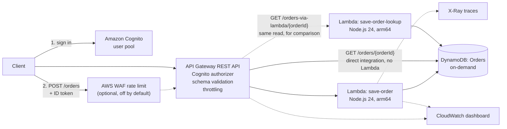
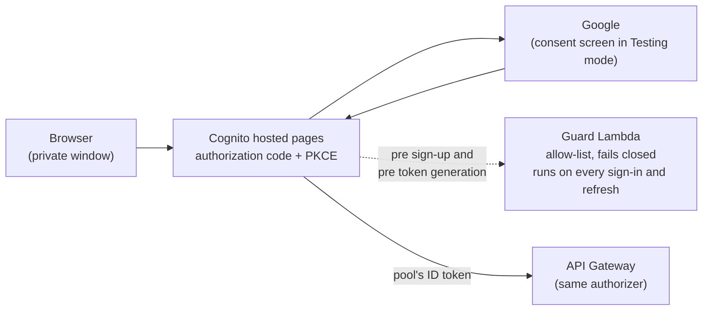
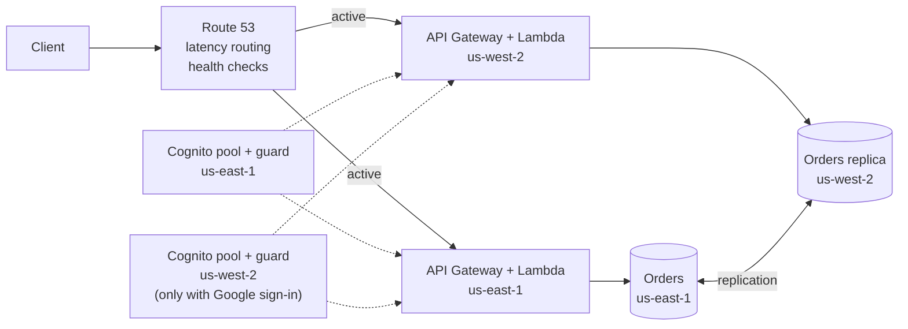
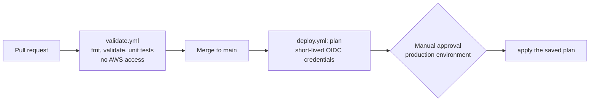

# Secure Serverless Orders API on AWS

A small serverless API built the way a production one should be: authenticated, validated, least-privilege,
observable, and deployed through a pipeline that holds no AWS keys. Everything is Terraform.

[](https://github.com/bdahiya2007/secure-serverless-api-aws/actions/workflows/validate.yml)
[](https://github.com/bdahiya2007/secure-serverless-api-aws/actions/workflows/deploy.yml)

An authenticated client sends `POST /orders`. API Gateway checks the Cognito token and the request shape, a
Node.js Lambda validates it again and writes one item to DynamoDB, and the result is traced and charted. Reading an
order back (`GET /orders/{orderId}`) skips Lambda entirely: API Gateway calls DynamoDB itself through a direct service
integration with request and response mapping templates. The same read also exists as a Lambda
(`GET /orders-via-lambda/{orderId}`), so both styles can be compared like for like.

Several features are built behind **off-by-default switches** because they bill or change behaviour, and each was measured in a short, time-boxed demo
and switched off again: an API stage cache, DAX, a WAF rate limit, **multi-region active/active** (a DynamoDB global table with a second API stack
behind Route 53), and **sign-in with Google** with an allow-list guard. See [Optional features at a glance](#optional-features-at-a-glance).

## Architecture



**Optional sign-in with Google** (off by default, `enable_federated_signin`): the same pool and the same ID token, with Google as the identity provider and a guard Lambda that lets only allow-listed addresses in.



**Optional multi-region active/active** (off by default, `enable_multi_region`): Orders becomes a DynamoDB global table, and a second copy of the API runs in another region behind Route 53.



With multi-region alone there is **one** user pool (us-east-1) that both APIs trust. With Google sign-in on as well, **each region has its own pool and guard and both APIs trust both pools**, so sign-in does not depend on one region (verified live: each pool's token was accepted by both APIs).

**Delivery pipeline:** nothing reaches AWS without a reviewed pull request, and nothing changes AWS without an approval.



## What this demonstrates

- **Infrastructure as code, modular:** ten reusable Terraform modules with validated inputs and plan-time guardrails.
- **Direct service integration:** API Gateway reads DynamoDB with no Lambda, using VTL mapping templates and a read-only role.
- **Security by default:** least-privilege IAM, a permissions boundary, no stored credentials, defense in depth on input.
- **Cost awareness:** idle cost is about $0, and every billed feature is off until deliberately enabled.
- **Delivery discipline:** PR validation without AWS access, OIDC to AWS, manual approval, remote locked state.
- **Operability:** a CloudWatch dashboard, X-Ray tracing, structured logs with bounded retention.
- **Resilience and identity (optional):** multi-region active/active with measured replication lag and failover, and sign-in with Google behind an allow-list guard that also locks out removed users on refresh. Both were tested live and written up with their limits ([DISASTER_RECOVERY.md](docs/DISASTER_RECOVERY.md), [COGNITO_TESTING_RUNBOOK.md](docs/COGNITO_TESTING_RUNBOOK.md)).

## Security design

| Area | What is in place |
|---|---|
| **Authentication** | Cognito user pool (Lite tier), admin-created users only, strong password policy, optional TOTP MFA (optionally Google sign-in behind an allow-list guard; see below). API Gateway rejects requests without a valid ID token before the Lambda runs. |
| **Federated sign-in (optional)** | Google through Cognito's hosted pages (authorization code with PKCE, a separate Google-only app client with no secret and no password flow). A guard Lambda on the pre sign-up and pre token generation triggers admits only allow-listed addresses, on every sign-in **and refresh**, fails closed, and never logs an email. Tested: a non-listed Google account is refused with no user created, and a removed address is refused on refresh. **Known limit:** an ID token issued before removal works until it expires (up to 60 minutes). The client secret and the allow-list are supplied at apply time and never committed. |
| **Input handling** | The API validates the body against a JSON Schema, and the Lambda validates again with an allow-list of fields. Malformed JSON and unknown fields get a 400 that never echoes the input. |
| **No overwrites** | Writes use a condition expression, so an existing `orderId` + `itemId` returns 409 instead of being replaced. |
| **Direct DynamoDB reads** | API Gateway assumes a role that can only `Query` the one Orders table, and the module rejects any write action or wildcard. The request template passes the path parameter as a string value (never as part of the query) and escapes it, and unmatched content types are rejected. DynamoDB errors are replaced with fixed 400 and 500 bodies, so internal details never reach the client. |
| **Least-privilege IAM** | The Lambda role can `PutItem` on one table ARN and write to its own log group. The module rejects `*` actions and resources at plan time, with one documented exception (X-Ray write actions cannot be scoped). |
| **Permissions boundary** | Every role the pipeline creates must carry a boundary that caps it at logging, X-Ray writes and Orders table data access. |
| **Pipeline identity** | GitHub OIDC with short-lived tokens, no stored keys. The trust policy pins the repository by immutable ID and allows only `main` (plan) and the `production` environment (apply). Pull requests cannot assume it. |
| **Pipeline cannot elevate itself** | The deploy role, boundary and state bucket live in a separately applied `bootstrap` stack. Explicit denies stop the role editing itself or removing the boundary. |
| **State** | Private, versioned, encrypted S3 bucket with TLS-only access and native locking. State and variable files are never committed. |
| **Account hardening** | S3 Block Public Access on for the whole account, deletion protection on the table and user pool. |
| **Repository** | Branch protection (admins included), required pull requests, secret scanning with push protection, GitHub Actions pinned by commit SHA. |
| **Optional speed-ups (off by default)** | The API Gateway stage cache and DAX are built behind switches that default to **off**, because they bill by the hour and trade freshness for speed. Cache entries are keyed by the order id, encrypted, and cannot be bypassed with `Cache-Control`; DAX sits behind a security group that admits only the read Lambda, with a read-only role and a TLS endpoint. When on, a read can be stale for up to the TTL after a write, and all signed-in users share cached responses. |
| **Leak prevention** | A pre-commit hook and a CI job scan for credentials, AWS account and resource IDs, personal data and state or key files, and redact what they report ([details](docs/SECRET_SCANNING.md)). |
| **Error and log hygiene** | 500 responses are generic, and logs record the error type and request ID, never order contents. |

## Optional features at a glance

All are off by default and applied locally for a short demo, then removed. Each has a runbook section, a check script in `scripts/demo/` and measured results.

| Switch | What it adds | Measured result | Details |
|---|---|---|---|
| `enable_api_cache` | API Gateway stage cache (300 s) | About 6 to 7% faster on repeated reads; stale up to the TTL; 404s cached | [DEMO_RESULTS.md](docs/DEMO_RESULTS.md) |
| `enable_dax` | DAX cluster for the read Lambda | **No gain**; cold start 0.58 s to 2.2 s; stale and cached-empty results | [DEMO_RESULTS.md](docs/DEMO_RESULTS.md) |
| `enable_waf` | WAF per-IP rate limit | Blocked a burst after about 231 requests (limit 100; enforcement lags) for about 5 minutes | [DEMO_RESULTS.md](docs/DEMO_RESULTS.md) |
| `enable_multi_region` | Global table replica, second-region API, Route 53 latency routing with health checks | Replication 0.3 to 1.2 s; a forced failover moved traffic in 31 s (a real one takes about 1.5 to 3 minutes); conflicts resolve to the last writer | [DISASTER_RECOVERY.md](docs/DISASTER_RECOVERY.md) |
| `enable_federated_signin` | Google sign-in, the guard Lambda, and (with multi-region) a pool per region | Refusal and lockout verified; each pool's token accepted by both APIs; free at this scale | [COGNITO_TESTING_RUNBOOK.md](docs/COGNITO_TESTING_RUNBOOK.md) |

## Cost awareness

Built and run in a personal AWS account, so cost is a design constraint. Idle cost is effectively zero:
DynamoDB is on-demand, Lambda and Cognito Lite sit inside their free tiers, and dashboards and metrics use only
free AWS-published data. Anything billed is off by default and documented:

| Feature | Approximate cost | State |
|---|---|---|
| AWS WAF per-IP rate limit | About $6/month while attached, billed hourly | Off (`enable_waf`) |
| DynamoDB point-in-time recovery | Per GB stored | Off |
| DynamoDB Accelerator (DAX), one node | About $0.05 per hour while on (node plus a Logs endpoint), with no free tier | Off (`enable_dax`); reads become eventually consistent and can be stale when on |
| API Gateway stage cache (300 s TTL) | Billed by the hour even when idle (not free-tier eligible) | Off (`enable_api_cache`); reads can be stale for up to the TTL when on |
| Sign-in with Google (hosted pages and a guard Lambda) | Free at this scale: Cognito Lite and Lambda free tiers; Google is free | Off (`enable_federated_signin`); anyone could sign in without the guard, so the guard is mandatory |
| Multi-region active/active (global table replica, second-region API, Route 53 health checks) | Every write billed again in the replica region, plus storage, a second stack and health checks; cents for a short demo | Off (`enable_multi_region`); last-writer-wins on conflicting writes, asynchronous replication |
| REST API requests | About $3.50 per million | On, pennies at this scale |

## Repository layout

```
terraform/
├── bootstrap/            # applied manually: state bucket, permissions boundary, CI deploy role
├── environments/dev/     # root configuration for the dev environment
├── modules/              # dynamodb-table, lambda-function, rest-api, cognito-user-pool,
│                         # apigw-dynamodb-role, dax-cluster, waf-rate-limit, cloudwatch-dashboard,
│                         # api-custom-domain, route53-multi-region
└── README.md             # full technical reference and runbook
src/save-order/           # write Lambda: source and unit tests
src/get-order/            # read Lambda (Lambda alternative to the direct read): source and unit tests
src/signin-guard/         # Cognito trigger that allow-lists Google sign-ins (optional): source and unit tests
scripts/e2e-test.sh       # end-to-end smoke test with automatic cleanup
scripts/secret-scan.py    # secret and sensitive-data scanner (pre-commit hook and CI)
scripts/check-doc-links.py  # checks every Markdown link and heading anchor (CI)
scripts/benchmark/        # cold-start and memory benchmark (temporary function, cleans up)
scripts/compare-reads.sh  # interleaved latency comparison: direct read vs Lambda read (cleans up)
scripts/demo/             # behaviour checks and helpers for the cache, DAX, WAF, multi-region and Google sign-in demos (see docs/DEMO_RESULTS.md)
scripts/build-dax-package.sh  # builds the read Lambda package with the DAX client (only for the optional DAX switch)
.github/workflows/        # validate.yml and deploy.yml
docs/                     # TESTING.md, SECRET_SCANNING.md, OPTIMIZATION_GUIDE.md, DEMO_RESULTS.md (cache, DAX, WAF, multi-region and Google sign-in demos), DISASTER_RECOVERY.md, COGNITO_TESTING_RUNBOOK.md, FAQ.md (design and measurement questions) and the IAM policy for the engineer's SSO permission set
```

## Try it

Setup, deployment and the cost switches are documented in the [Terraform reference](terraform/README.md),
including how to create a test user. Once deployed, a call looks like this:

```bash
curl -X POST "$API_URL/orders" \
  -H "Authorization: $ID_TOKEN" -H "Content-Type: application/json" \
  -d '{"orderId":"o-1001","itemId":"i-1","quantity":2,"price":9.99}'
```

| Response | Meaning |
|---|---|
| `201` | Saved |
| `400` | Rejected by API Gateway or the Lambda: invalid body |
| `401` | Missing or invalid token |
| `409` | That order item already exists |

Reading an order back needs the same token, and there are two ways to do it, so they can be compared:

```bash
curl "$API_URL/orders/o-1001" -H "Authorization: $ID_TOKEN"
```

| Response | Meaning |
|---|---|
| `200` | `{ "orderId", "itemCount", "items": [ { "itemId", "quantity", "price", "createdAt" } ] }` (missing optional fields are `null`) |
| `404` | No such order |
| `401` | Missing or invalid token |

The Lambda version, `GET /orders-via-lambda/{orderId}`, returns the same data with three differences: compact JSON, a
`"truncated"` flag that tells the client when the 100-item cap cut the list off (the direct read cannot), and **`400`** for an
invalid id (a Lambda can validate ids with an allow-list, while the direct read treats any id as a lookup and returns 404).

To sign in with Google instead of a CLI test user (optional, `enable_federated_signin`), run `scripts/demo/google-signin.py --private` and sign in with an allowed address in
the private window; it saves the ID token locally (never printed) and `scripts/demo/federated-checks.sh` exercises the APIs with it. The step-by-step procedure, for one and two regions, is in
[COGNITO_TESTING_RUNBOOK.md](docs/COGNITO_TESTING_RUNBOOK.md).

The full [testing guide](docs/TESTING.md) covers unit tests, an end-to-end script that cleans up after itself,
observability checks and the pipeline. The three Lambdas have 44 unit tests using Node's built-in runner and no
dependencies:

```bash
node --test "src/*/*.test.mjs"
```

## Performance

The Lambda was tuned from measurements, not assumptions. The brief was to shrink the deployment package and keep
initialization out of the handler. Both turned out to be already true, and the benchmark showed where the real
latency was.

**Already in place**
- **Package: 2,089 bytes zipped** (two source files). The AWS SDK comes from the Lambda runtime and the tests are
  excluded, so there is almost nothing left to remove.
- **Initialization is outside the handler.** The DynamoDB client and `TABLE_NAME` are created at module level, once
  per execution environment, not per request.

**Method.** A temporary copy of the function (same role, `nodejs24.x`, arm64, X-Ray active tracing) was benchmarked
so production was never touched. The matrix was 3 code variants x 3 memory sizes, with 10 forced cold starts and
5 warm requests per configuration. Every request was a real DynamoDB write. Timings come from Lambda's own report
line (`Init Duration` and `Duration`), and a sample counts as cold only if it has an init phase. In all, 135 invocations
(86 cold, 49 warm); the table shows medians.

| Variant | What it changes |
|---|---|
| `baseline` | The production code |
| `slim-imports` | Low-level DynamoDB client only (drops `lib-dynamodb`) to load fewer modules |
| `init-warmup` | `slim-imports` plus client timeouts and credentials/region resolved during init |

**Results**

| Variant | Memory | Cold samples | Init (ms) | First request (ms) | **Cold total (ms)** | vs current | Cold p90 (ms) | Warm (ms) | GB-s per cold request |
|---|---|---|---|---|---|---|---|---|---|
| baseline (current) | 128 MB | 10 | 308 | 983 | **1,281** | | 1,322 | 70 | 0.160 |
| slim-imports | 128 MB | 10 | 317 | 973 | **1,290** | +1% | 1,315 | 73 | 0.161 |
| init-warmup | 128 MB | 10 | 304 | 975 | **1,276** | 0% | 1,330 | 70 | 0.160 |
| baseline | 256 MB | 10 | 314 | 493 | **814** | -36% | 856 | 26 | 0.204 |
| slim-imports | 256 MB | 10 | 307 | 485 | **794** | -38% | 815 | 24 | 0.199 |
| init-warmup | 256 MB | 9 | 294 | 490 | **785** | -39% | 808 | 31 | 0.197 |
| baseline | **512 MB** | 10 | 269 | 233 | **509** | **-60%** | 561 | **11** | 0.255 |
| slim-imports | 512 MB | 7 | 259 | 214 | **486** | -62% | 508 | 12 | 0.244 |
| init-warmup | 512 MB | 10 | 296 | 235 | **532** | -58% | 545 | 11 | 0.267 |

*Cold total = init + first request. Billed duration was about equal to cold total in these runs, so init is billed.*

**What the numbers say**
- **Code changes did not help.** Slimmer imports and init warm-up are within about 3% of baseline at every memory
  size, which is inside the run-to-run noise. They were measured, rejected, and not shipped.
- **Memory is the lever.** At 128 MB the function has almost no CPU, so loading and compiling the SDK dominates the
  first request. At 512 MB a cold request drops from 1.28 s to 0.51 s and a warm request from 70 ms to 11 ms.
- **Headroom.** At 128 MB the function peaked at about 102 MB (80% of the limit); 256 MB and 512 MB remove that risk.
- **Cost stays negligible.** A cold request uses more GB-s at higher memory (0.16 to 0.26), but a *warm* request, the
  common case, is cheaper: 8.8 mGB-s at 128 MB, 6.5 at 256 MB, 5.5 at 512 MB. Lambda's always-free monthly allowance
  (1 million requests and 400,000 GB-s, on both arm64 and x86, per the AWS Lambda pricing page) covers the compute
  for about 1.5 million requests even if every one were a cold start at 512 MB. Requests beyond the first million cost
  $0.20 per million, so the request count, not memory, is the limit. Initialization is billed as well, which is why cold
  requests cost more.

**Decision:** memory raised from 128 MB to **512 MB**; code unchanged.

### Request latency

Measured end to end from one client (30 requests per path, a new TCP and TLS connection each time, warm function):

| Path | Median | p90 |
|---|---|---|
| API Gateway only (unauthenticated `GET`, rejected with 401, no backend) | 274 ms | 285 ms |
| `GET /orders/{id}`, direct DynamoDB integration (no Lambda) | 353 ms | 374 ms |
| `POST /orders`, Lambda (512 MB) plus DynamoDB write | 327 ms | 339 ms |

The network round trip dominates (the 401 row is already 274 ms), and that table compares a read with a write, so it is only
indicative. A **like-for-like comparison** followed once the same read also existed as a Lambda. Two interleaved runs against
the deployed API (`./scripts/compare-reads.sh`; 50 and 100 rounds per path, a new connection per request):

| Path | Run A median | Run A p90 | Run B median | Run B p90 |
|---|---|---|---|---|
| API Gateway only (401, no backend) | 291 ms | 323 ms | 276 ms | 291 ms |
| `GET /orders/{id}`: direct DynamoDB integration | 377 ms | 456 ms | 352 ms | 382 ms |
| `GET /orders-via-lambda/{id}`: Lambda + DynamoDB | **338 ms** | 380 ms | **322 ms** | 342 ms |

**The Lambda read was faster, by about 30 to 40 ms at the median, in both runs**, even though it adds a hop: the function itself
runs in about 6 ms, and most of the extra time is API Gateway invoking it. The direct read is not faster; what it saves is about
$0.25 per million requests and a function to run, and it has no Lambda cold start (the Lambda read pays about 0.58 s once per
environment). The Lambda read also validates ids, flags truncation, and leaves logs and traces. Why the direct integration is
slower is an informed guess, not a measurement; see the [optimization guide](docs/OPTIMIZATION_GUIDE.md#33-direct-read-against-lambda-read-like-for-like).

### Caching options and WAF (built, off by default, measured in a demo)

Three features are built behind switches that default to **off**: an **API Gateway stage cache** (`enable_api_cache`, 300 s TTL), a **DAX
cluster** for the read Lambda (`enable_dax`, 60 s TTL) and a **WAF per-IP rate limit** (`enable_waf`). On 2026-10-10 each was switched
on in turn, measured against a baseline and switched off again (the whole demo cost roughly $0.10 to $0.15):

| Setup | Lambda read median | Direct read median | Verdict |
|---|---|---|---|
| Everything off (baseline) | 322 ms | 352 ms | |
| DAX on | 322 ms | 348 ms | **No gain**; cold start 0.58 s to 2.2 s; stale and cached-empty results for 60 s |
| API cache on | 299 ms | 331 ms | **About 21 to 23 ms (6 to 7%) faster** on repeated reads; stale for up to 300 s; 404s cached |
| WAF on | n/a | n/a | Blocked a single IP after about 231 requests (limit 100; enforcement lags) for about 5 minutes |
| All three on | 313 ms | 344 ms | Within noise of the cache alone |

About 270 ms of every figure is network and TLS from the test client, and the Lambda itself runs in about 6 ms, so there is little
for DAX to save. The API cache helps only repeated reads of the same id. Both make reads stale after a write, and a cache flush takes
about 50 s to take effect. The full per-phase results, behaviour checks and costs are in [docs/DEMO_RESULTS.md](docs/DEMO_RESULTS.md); the
risks are in the [optimization guide](docs/OPTIMIZATION_GUIDE.md) and the
[runbook](terraform/README.md#dynamodb-accelerator-dax-optional-billed-off-by-default).

### Cost and security trade-offs

- **Cost:** API Gateway at about **$3.50 per million requests** is 80 to 96% of any request's cost, so Lambda tuning moves
  cents. Per million requests: a Lambda write about $4.40, a direct read about $3.63 (the same read via a Lambda about
  $3.87). 512 MB makes warm requests cheaper but cold ones about 59% dearer in compute. Provisioned concurrency, which
  removes cold starts, would cost about $5.40 per month for one 512 MB environment, even when idle. The API Gateway free
  tier does not apply to this account.
- **Security:** the main risks are request data leaking through module-level state (kept out by design), template
  injection in the direct read (mitigated and tested), and the missing ownership model (any signed-in user can read any
  order). Reads also have weaker visibility: no Lambda logs, X-Ray traces or API access logs.

The full treatment, with the decision table for every technique, the cost arithmetic and a security-risk table, is in the
[optimization guide](docs/OPTIMIZATION_GUIDE.md).

**Limits of this measurement:** about 10 cold samples per configuration, one account and region, run on one day, and
X-Ray tracing included in the timings. Treat differences of a few percent as noise.

**Reproduce it.** The benchmark creates its own temporary function, never modifies production, and deletes the
function and its test rows on exit:

```bash
./scripts/benchmark/run.sh                       # full matrix, about 5 minutes
MEMORIES="256 512" VARIANTS="baseline" BATCHES=1 ./scripts/benchmark/run.sh   # a smaller run
```

It needs an AWS session and room for 5 parallel invocations (the account default is 10). Variants live in
[scripts/benchmark/](scripts/benchmark/README.md).

## Design decisions

- **REST API, not HTTP API.** The requirement named a REST API, which also provides request validation and
  usage controls. An HTTP API is cheaper and would suit a simpler need.
- **Both read styles are built.** `GET /orders/{orderId}` is the direct integration and
  `GET /orders-via-lambda/{orderId}` is the same read in a Lambda, so the choice can be made on measurements.
  `scripts/compare-reads.sh` runs the like-for-like comparison.
- **Lambda proxy integration for writes, direct DynamoDB integration for reads.** Writes use a Lambda so the contract
  and validation live in code that can be unit-tested. Reads need no logic beyond mapping, so API Gateway calls
  DynamoDB itself: no Lambda to run, patch or pay for, and no Lambda cold start. It was measured **30 to 40 ms slower** than
  the same read through a Lambda (see [Request latency](#request-latency)), so the choice is cost and simplicity against speed
  and features. The trade-offs are that VTL templates have no unit tests (they are verified end
  to end), reads are limited to 100 items per order and silently truncated beyond that, reads leave no Lambda logs or
  X-Ray traces, and the response shape is coupled to DynamoDB's typed JSON through the template.
- **Node.js 24, not 26.** Node.js 26 is still a Lambda public preview, so the latest generally available runtime
  was used.
- **512 MB of memory, from a benchmark.** More memory means more CPU, which cut cold starts by 60% and warm requests
  by 84%; code-level optimizations did not measurably help (see [Performance](#performance)).
- **Runtime-included AWS SDK.** This avoids an npm build step. AWS recommends bundling the SDK for strict version
  control, which is a listed follow-up.
- **ID token authorizer.** Simplest correct option for a first version. Scopes and an access-token flow would suit
  multiple resource servers.
- **Separate bootstrap stack.** Slightly more manual work, in exchange for a pipeline that cannot rewrite its own permissions.
- **Google as the identity provider, with a guard on the token trigger.** Cognito cannot replicate users between regions, so a pool per region with Google behind both avoids copying users. Pre sign-up alone would not stop a user who already has a profile, so the guard also runs on every token (the cost: tokens issued before a removal live until they expire).
- **Active/active with one name, health-checked.** Route 53 latency routing sends each client to the nearest healthy region. The health route is shallow (it proves API Gateway is up, not DynamoDB), which is a documented gap.
- **Features that bill are switches, applied locally.** The deploy role has no second-region, Route 53 or ACM access by design, and a push to `main` applies with every switch off.

## Known limitations and roadmap

What this project does not do, why, and what comes next. When something ships, it is removed from this list in the same pull request.

### Gaps worth closing (most valuable first)

| Gap | Impact | Why it is open, and the next step |
|---|---|---|
| **Per-user ownership of orders** | **Any signed-in user can read any order by its id.** Orders record no owner, and if the API cache is on, cached responses are shared between users. | Needs the caller's Cognito id stored on each order, reads filtered by it on both read paths, and the cache keyed by identity or skipped. It touches the Lambdas, the data model and the API, so it is a separate piece of work. **The most important next step.** |
| **Pagination and a truncation signal** | A read returns at most 100 items. The Lambda read reports `"truncated": true`; the direct read cuts off silently, so a client cannot tell. | A small template change for the flag; pagination needs a continuation token in the API. |
| **Failover depth and a backup** | The failover health check only proves API Gateway is up (not DynamoDB or Lambda), and point-in-time recovery is off, so a bad write or delete replicates to both regions. | A deeper health check and point-in-time recovery (billed per GB); see [DISASTER_RECOVERY.md](docs/DISASTER_RECOVERY.md#known-gaps-and-what-to-do-before-relying-on-this). |
| **Alarms** | Nothing notifies anyone of errors or throttling; there is a dashboard only. The dashboard does not yet chart the read Lambda and routes. | CloudWatch alarms (the first 10 are free) with email notification. |
| **API access logs** | Reads leave no Lambda logs, no X-Ray trace and no access log, which limits auditing. | Needs an account-wide API Gateway CloudWatch role and has a small cost, so it needs a decision first. |

### Built, but switched off

| Feature | State |
|---|---|
| **API Gateway stage cache** (`enable_api_cache`) and **DAX** (`enable_dax`) | **Off by default** because they bill by the hour and make reads stale for up to their TTL. Measured in a demo: the cache saved about 6 to 7% on repeated reads, DAX saved nothing (see Performance and [DEMO_RESULTS](docs/DEMO_RESULTS.md)). |
| **Multi-region active/active** (`enable_multi_region`) | Built and demonstrated live (20 minutes, a few cents), then switched off. Orders becomes a DynamoDB global table with a replica in `us-west-2`, a second API stack runs there, and Route 53 latency routing with health checks sends each client to the nearest healthy region at one custom name. Off by default because it bills and needs a domain; applied locally for a short demo. Measured: replication 0.3 to 1.2 s, cross-region sign-in works, a forced failover moved traffic in 31 s (a real one takes about 1.5 to 3 minutes), conflicting writes resolve to the last writer. See [DISASTER_RECOVERY.md](docs/DISASTER_RECOVERY.md), [DEMO_RESULTS.md](docs/DEMO_RESULTS.md) and [the runbook](terraform/README.md#multi-region-activeactive-global-table-optional-billed-off-by-default). |
| **Sign-in with Google** (`enable_federated_signin`) | Built and **verified live in one and two regions** (then switched off; see [COGNITO_TESTING_RUNBOOK.md](docs/COGNITO_TESTING_RUNBOOK.md)). Cognito's hosted pages send the user to Google (authorization code with PKCE), a guard Lambda lets only allow-listed addresses in on sign-up and on every token, and with multi-region on both APIs trust a pool in each region, so sign-in no longer depends on one region. Measured: a non-listed Google account is refused at sign-up with no user created; a removed address is refused on refresh, but an already-issued ID token works until it expires (up to 60 minutes); each pool's token is accepted by both APIs. Free at this scale; applied locally with your own Google OAuth client. See [the runbook](terraform/README.md#sign-in-with-google-optional-off-by-default). |
| **WAF per-IP rate limit** (`enable_waf`) | Off by default (about $6 a month). Applied and tested live in the demo: it blocked a burst from one IP (enforcement lags the limit). Worth enabling for real traffic. |

### Out of scope on purpose

| Not done | Why |
|---|---|
| Update and delete endpoints, and listing orders | The project demonstrates a create path and two read paths. A list needs a design (a `Scan` is unbounded and would expose every order), not just an endpoint. |
| A browser front end and CORS | Out of scope for an API. |
| More environments (staging, prod) | One `dev` environment keeps cost and complexity low. Multi-region is built as an optional, off-by-default switch (see [Built, but switched off](#built-but-switched-off) and [DISASTER_RECOVERY.md](docs/DISASTER_RECOVERY.md)), but there is no separate production environment, state or approval path. |
| A custom domain **in the default setup** | The API uses its default `execute-api` URL. A custom domain with a free certificate per region exists only inside the optional multi-region switch, because Route 53 needs an existing hosted zone and the names are not committed. |
| A federated or production sign-in design | Sign-in uses one Cognito pool and the CLI password flow, for testing. Federation with an identity provider, hosted sign-in (PKCE) and a pool per region are described in [DISASTER_RECOVERY.md](docs/DISASTER_RECOVERY.md#known-gaps-and-what-to-do-before-relying-on-this) but not built. |
| esbuild bundling, provisioned concurrency, an HTTP API, eventually consistent reads without DAX, the cache with many distinct ids | Listed as not evaluated in the [optimization guide](docs/OPTIMIZATION_GUIDE.md#8-not-evaluated). |
| The X-Ray SDK for DynamoDB sub-segments | Needs a bundled dependency, which the default package deliberately avoids. |

## Related

[three-tier-web-app-aws](https://github.com/bdahiya2007/three-tier-web-app-aws) is another project in this portfolio.
It uses the same OIDC, approval-gated deployment approach with CloudFormation.
